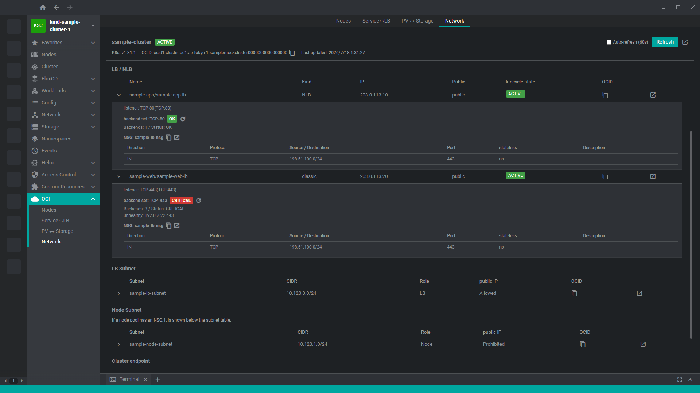

# freelens-oci-cluster

See the OCI resources backing your open cluster, right in FreeLens.

[日本語](README.md)

The extension visualizes relationships between Kubernetes and Oracle Cloud Infrastructure (OCI) resources that FreeLens does not show by default.

- Node → Instance
- Service (type=LoadBalancer) → NLB / classic LB
- PersistentVolume → Block Volume / FSS

Starting from each Node's `providerID`, it automatically resolves OCI resources related to the open cluster.
It never performs operations that mutate OCI resources.

## Prerequisites

FreeLens 2.0.0 or later (see `engines` in `package.json`) and an authenticated `oci` CLI are required.
It does not load on FreeLens 1.x.
On FreeLens 1.x, use v0.6.0, the last release for 1.x.

For each data fetch, the extension spawns `oci` from the FreeLens main process and reads its JSON output.
It never receives keys or tokens; authentication remains entirely inside `oci`.
You can also configure a wrapper command or an `oci` installation running under WSL.

## Install

1. Download the latest `.tgz` from [GitHub Releases](https://github.com/AvapCoLtd/freelens-oci-cluster/releases).
2. On the Extensions screen in FreeLens, specify the downloaded `.tgz` to install it.
3. If `freelens-oci-cluster` is disabled on the Extensions screen, enable it.
4. Repeat the same operation with a new `.tgz` when updating.

On Windows, the installed extension is placed in `%APPDATA%\Freelens\extensions\freelens-oci-cluster`.

## Usage

Connect to a cluster in FreeLens and open the "OCI" menu in the cluster sidebar.
The following pages are available for OKE clusters.
For non-OKE clusters, the extension displays an out-of-scope message.

| Page | Contents |
|---|---|
| Nodes | K8s Node to OCI Instance mappings (shape, OCPU / memory) and a node pool summary |
| Service↔LB | LoadBalancer Service to NLB / classic LB mappings |
| PV ↔ Storage | PersistentVolume to Block Volume / FSS mappings and backup policies |
| Network | DNS (with a console link to the matching OCI DNS zone), WAF, LB/NLB, subnet, route, and backend health checks in outside-in path order |
| Topology | A diagram of cluster-related resources and their connections |

The search bar on each page filters displayed content, including expandable details.
A header toggle enables auto-refresh; its interval is configurable in Preferences (60 seconds by default).

On the Topology page, subnets with more than 10 instances collapse into per-node-pool aggregate nodes (click to expand).

The legend at the bottom left toggles each row; clicking an edge kind hides it from the diagram (hidden rows stay dimmed).
Allow edges derived from Security List / NSG ingress rules (Allowed by Security List / Allowed by NSG) have legend rows just like the other kinds.
They are shown by default and can be hidden with a click.
LB → Instance edges are colored by backend health, and the meaning of each color is listed indented under the same legend row.
This health row is also a toggle; hiding, for example, Backend OK leaves only the warning and critical edges on the diagram.

The copy button in the Topology page header writes the diagram on screen to the clipboard as Mermaid flowchart text, or as a standalone SVG.
The copy button exports only the edges currently visible in the diagram.

## Settings

Set the command to run in the "OCI: oci command" field in FreeLens Preferences.

- A blank value uses the `oci` found on `PATH`.
- Leading arguments are allowed, such as `oci --profile foo`.
- Wrapper commands such as `wsl oci` are supported.
- The value is split on whitespace; quotes are not interpreted.

Changes take effect on the next data fetch.
See [OCI command integration](docs/oci-command.en.md) for the compatible-command output, timeout, and paging contract.

## Documentation

| Task | Reference |
|---|---|
| Set up development, run tests, or release | [Contributing](CONTRIBUTING.en.md) |
| Understand resource mapping and design rationale | [Design decisions](docs/design.md) |
| Implement an `oci` wrapper or compatible command | [OCI command integration](docs/oci-command.en.md) |
| Review findings about the FreeLens Extension API | [FreeLens Extension API sources](docs/extension-api.md) |

## Repositories

- [GitHub (public and releases)](https://github.com/AvapCoLtd/freelens-oci-cluster)
- [GitLab (development)](https://gitlab.avaper.day/avap/freelens-plugins/freelens-oci-cluster)

## License

MIT
