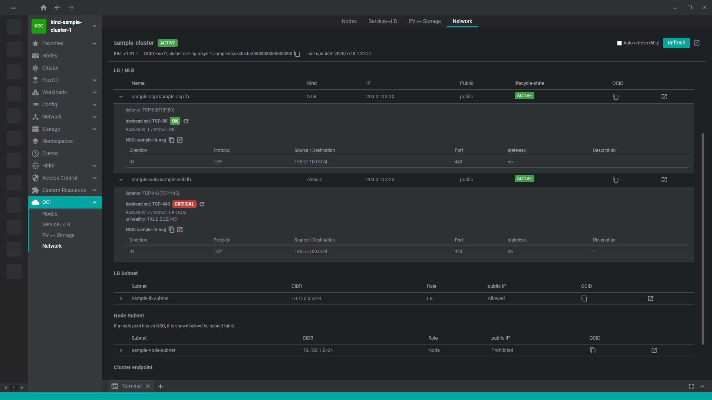

# freelens-oci-cluster

開いているクラスタの基盤OCIリソースをFreeLens上で確認できるようにする。

[English](README.en.md)

KubernetesとOracle Cloud Infrastructure（OCI）の対応関係を可視化する。
この情報はFreeLensの標準機能では表示されない。

- Node → Instance
- Service（type=LoadBalancer）→ NLB / classic LB
- PersistentVolume → Block Volume / FSS

Nodeの `providerID` を起点に、開いているクラスタに関係するOCIリソースを自動解決する。
OCIリソースを変更する操作は行わない。

## 前提条件

FreeLens 2.0.0以上（`package.json` の `engines` を参照）と、認証済みの `oci` CLIが必要。
FreeLens 1.xでは読み込まれない。
FreeLens 1.xでは、1.x向けの最後のリリースであるv0.6.0を使う。

プラグインはデータ取得のたびに、FreeLensのメインプロセスから `oci` を子プロセスとして実行し、JSON出力を読む。
鍵やトークンは受け取らず、認証は `oci` の内部で完結する。
ラッパコマンドやWSL上の `oci` も設定できる。

## インストール

1. [GitHub Releases](https://github.com/AvapCoLtd/freelens-oci-cluster/releases)から最新の `.tgz` をダウンロードする。
2. FreeLensのExtensions画面で、ダウンロードした `.tgz` を指定してインストールする。
3. Extensions画面で `freelens-oci-cluster` が無効になっていれば、有効にする。
4. 更新時も新しい `.tgz` で同じ操作を行う。

Windowsでは、インストールした拡張は `%APPDATA%\Freelens\extensions\freelens-oci-cluster` に置かれる。

## 使い方

FreeLensでクラスタへ接続し、クラスタサイドバーの「OCI」メニューを開く。
OKEクラスタでは次のページを利用できる。
非OKEクラスタでは対象外である旨を表示する。

| ページ | 内容 |
|---|---|
| Nodes | K8s NodeとOCI Instanceの対応（シェイプ・OCPU / メモリ）、ノードプールのサマリ |
| Service↔LB | LoadBalancer ServiceとNLB / classic LBの対応 |
| PV ↔ Storage | PersistentVolumeとBlock Volume / FSSの対応、バックアップポリシー |
| Network | DNS（該当OCI DNSゾーンへのコンソール遷移つき）、WAF、LB/NLB、サブネット、ルート、backend healthを外から内の経路順に確認 |
| Topology | クラスタ関連リソースの位置と接続を一枚の図で表示 |

各ページの検索バーは、展開領域を含む表示内容を絞り込む。
ヘッダのトグルで自動更新を有効にでき、更新間隔はPreferencesで変更できる（既定60秒）。

Topologyページでは、Instanceが10を超えるサブネットをノードプール単位の集約ノードへ畳む（クリックで展開）。

図の左下の凡例は各行がトグルで、クリックしたエッジ種別を図から外す（隠した行は減光して残る）。
SL / NSGのingressルールから導いた通信許可のエッジ（Allowed by Security List / Allowed by NSG）も、他の種別と同じく凡例に行を持つ。
このエッジは既定で表示しており、クリックで外せる。
LB → Instanceのエッジはbackend healthで塗り分けており、その色の意味は凡例の同じ行の下に字下げして並ぶ。
このhealthの行もトグルで、たとえばBackend OKを隠せば警告と障害のエッジだけが図に残る。

Topologyページのヘッダにあるコピーボタンは、表示中の図をMermaid flowchartのテキスト、または単体で開けるSVGとしてクリップボードへ書き出す。
コピーボタンが書き出すのは、そのとき図に見えているエッジだけである。

## 設定

FreeLensのPreferencesにある「OCI: oci command」へ実行コマンドを設定する。

- 空欄ではPATH上の `oci` を使う。
- `oci --profile foo` のような前置引数を指定できる。
- `wsl oci` のようなラッパコマンドを指定できる。
- 値は空白で分割され、クォートは解釈されない。

変更は次回のデータ取得から反映される。
互換コマンドの出力、タイムアウト、ページングなどの契約は[OCIコマンド連携](docs/oci-command.md)を参照。

## ドキュメント

| やりたいこと | 参照先 |
|---|---|
| 開発環境を準備する、テスト・リリースを行う | [Contributing](CONTRIBUTING.md) |
| OCIリソースの対応関係や設計理由を確認する | [設計判断の記録](docs/design.md) |
| `oci` のラッパ・互換コマンドを実装する | [OCIコマンド連携](docs/oci-command.md) |
| FreeLens Extension APIの調査結果を確認する | [FreeLens拡張APIの情報源](docs/extension-api.md) |

## リポジトリ

- [GitHub（公開・リリース）](https://github.com/AvapCoLtd/freelens-oci-cluster)
- [GitLab（開発）](https://gitlab.avaper.day/avap/freelens-plugins/freelens-oci-cluster)

## License

MIT
